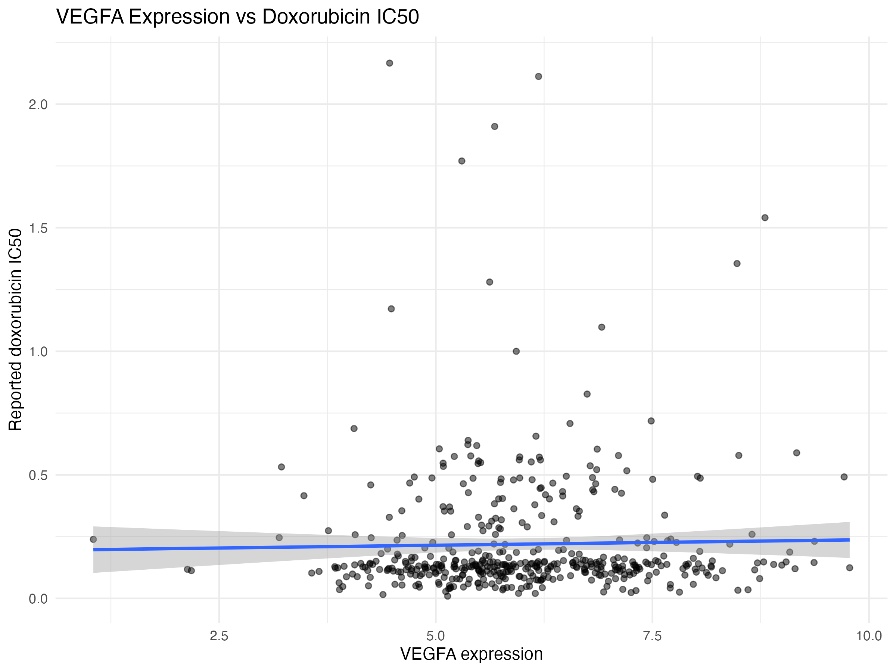
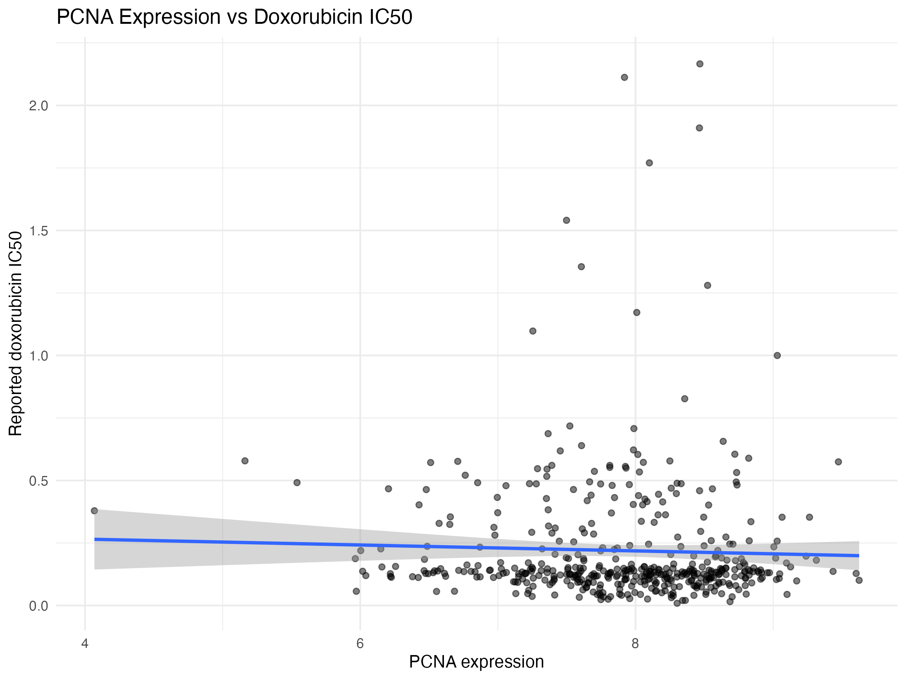
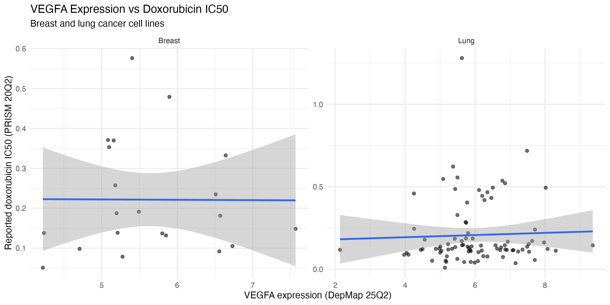
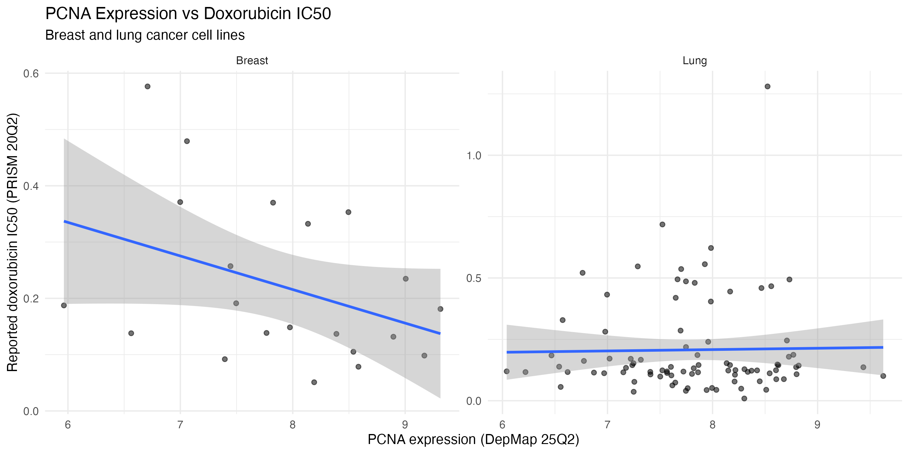

# Doxorubicin sensitivity and VEGFA/PCNA expression in cancer cell lines (DepMap and PRISM)

An exploratory R project using public data. I work on nanoparticle delivery of doxorubicin in breast and lung cancer cells, where I measure VEGFA (angiogenesis) and PCNA (proliferation). This project asks whether baseline expression of those two genes relates to how sensitive cancer cell lines are to free doxorubicin. I'm a molecular and cell biologist learning bioinformatics, so this is a learning project.

Related project: baseline VEGFA and PCNA expression in my cell lines (https://github.com/Gaya3mahesh/depmap-cancer-gene-expression).

## Question

Does baseline VEGFA or PCNA expression relate to doxorubicin sensitivity across cancer cell lines, and within breast and lung cell lines?

## Data

All data is public and comes from the DepMap portal (https://depmap.org/portal). The data files are not included here. Please download them from the DepMap Data Downloads page and place them in a folder called `data`.

- Drug response: PRISM Repurposing Secondary Screen 20Q2, file `secondary-screen-dose-response-curve-parameters.csv`, saved locally as `prism-repurposing-20q2-secondary-screen-dose-response-curve-parameters.csv`. Doxorubicin was tested at 8 doses, from 10 uM in 4-fold dilutions.
- Expression: DepMap Public 25Q2, file `OmicsExpressionProteinCodingGenesTPMLogp1Stranded.csv` (log2 TPM + 1).

The drug screen (20Q2) and the expression data (25Q2) come from different releases. They are joined on the DepMap cell line ID.

Citations: DepMap, Broad (2025). DepMap Public 25Q2. Dataset. depmap.org. Drug data: Corsello et al., 2020, Nature Cancer (doi.org/10.1038/s43018-019-0018-6).

## Methods

1. Extracted doxorubicin dose-response parameters (IC50 and AUC) from PRISM. A few doxorubicin rows had no cell line ID and were removed, leaving one row per cell line from a single screen (HTS002). Lower IC50 and lower AUC both mean more sensitive.
2. Extracted VEGFA and PCNA expression from DepMap.
3. Joined the two datasets on cell line ID, giving 461 cell lines with both measurements.
4. Calculated Spearman correlations between each gene and IC50, across all lines and within breast (21 lines) and lung (89 lines). Breast and lung were identified from the CCLE cell line name. P values were adjusted with Benjamini-Hochberg.

## Results

My three cell lines (expression in log2 TPM + 1, IC50 in uM):

| Cell line | VEGFA | PCNA | Doxorubicin IC50 | Doxorubicin AUC |
|---|---|---|---|---|
| MDA-MB-231 | 7.57 | 7.97 | 0.148 | 0.584 |
| MCF-7 | 5.49 | 7.50 | 0.191 | 0.602 |
| NCI-H358 | 8.02 | 8.73 | 0.494 | 0.694 |

Gene expression vs doxorubicin IC50 (Spearman):

| Group | Gene | N | rho | P value | Adjusted P |
|---|---|---|---|---|---|
| All lines | VEGFA | 461 | 0.054 | 0.249 | 0.249 |
| All lines | PCNA | 461 | -0.082 | 0.079 | 0.157 |
| Breast | VEGFA | 21 | 0.010 | 0.964 | 0.964 |
| Breast | PCNA | 21 | -0.414 | 0.062 | 0.248 |
| Lung | VEGFA | 89 | 0.085 | 0.427 | 0.854 |
| Lung | PCNA | 89 | -0.036 | 0.741 | 0.964 |

## Conclusion

Baseline VEGFA and PCNA expression did not significantly predict sensitivity to free doxorubicin, either across all 461 cell lines or within breast or lung lines. The only hint was a negative trend between PCNA and IC50 in breast lines (higher PCNA, lower IC50, rho = -0.41), but it was not significant after adjustment and rests on only 21 cell lines, so I would not rely on it.

Of my own three cell lines, MDA-MB-231 was the most sensitive and NCI-H358 the least, even though NCI-H358 had the highest VEGFA and PCNA. With three cell lines this is an observation, not evidence.

These two genes are therefore not useful baseline predictors of free doxorubicin response in these data. This says nothing about nanoparticle delivery.

## Limitations

- Only free doxorubicin was analysed, not nanoparticle formulations.
- Expression (25Q2) and drug response (20Q2) are from different DepMap releases.
- IC50 values are fitted from an 8-dose curve and can be unreliable when the curve does not cross 50 percent viability inside the tested range. AUC was recorded but not yet analysed.
- Breast has only 21 cell lines in the drug screen, so breast tests have low power. The lung group includes all lung lines, not only NSCLC.
- Cell lines were not filtered by STR profiling status.

## How to reproduce

1. Install R and the tidyverse: `install.packages("tidyverse")`
2. Download the two files listed above into a `data` folder.
3. In RStudio, set the working directory to the project folder and run `analysis.R`.

The script saves figures to `figures` and result tables as CSV files in the project folder.

## Planned next

A pathway analysis asking which biological processes (apoptosis, DNA damage response, cell cycle, drug resistance) distinguish doxorubicin-sensitive from resistant lines, using genome-wide expression instead of two genes.

## About

Code written with AI assistance. Results checked by me against cell lines I know well.
